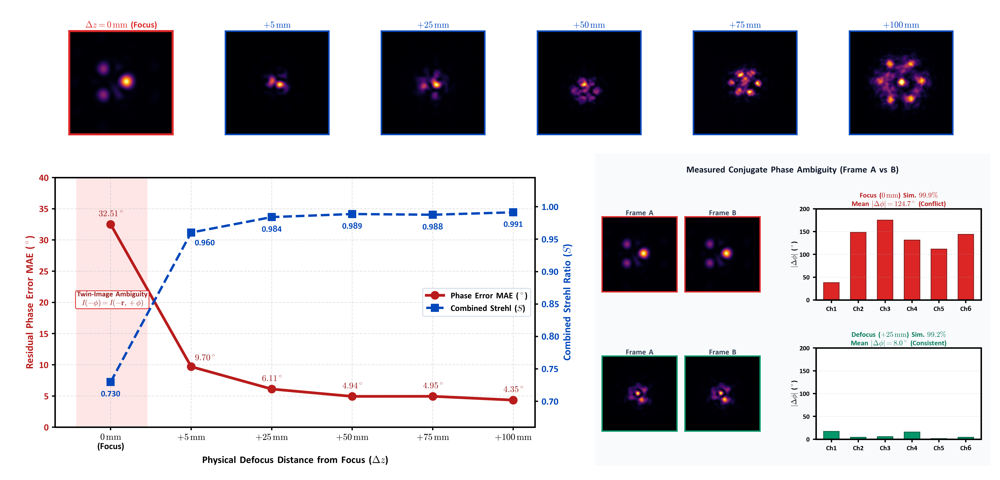
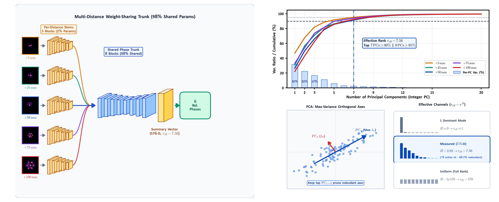

# Deep Learning for Single-Step Phase Optimization in Coherent Beam Combining

**Mobile-friendly companion guide** to our poster:
> **Deep learning for single-step phase optimization in coherent beam combining**  
> Sang-Eon Park¹, Sungmin Park¹, Dong-Il Yeom¹,*  
> ¹Department of Energy Systems Research, Ajou University (`*diyeom@ajou.ac.kr`)

This public repository provides the **physical intuition, lightweight compression methodology, visualizations, required libraries, references, and dataset-independent PyTorch example code** so researchers can reproduce and adapt the approach to their own multi-beam systems. *(No proprietary experimental datasets or private weights are included.)*

---

## 1. Visual Overview & Core Theory

### ① Breaking Twin-Image Ambiguity via Defocus ($\Delta z$)
At the focal plane ($\Delta z = 0\text{ mm}$), inversion symmetry $I(\mathbf{r}; -\boldsymbol{\phi}) = I(-\mathbf{r}; +\boldsymbol{\phi})$ makes conjugate phase signs indistinguishable (`MAE 32.51°`). Introducing a physical defocus ($\Delta z = +25\text{ to }+100\text{ mm}$) adds a quadratic Fresnel phase term $\exp(ikr^2 / 2\Delta z)$ that breaks this symmetry, enabling single-frame phase retrieval (`MAE 4.35°–6.11°`, `Strehl ≥ 0.984`).



---

### ② Shared Learning & Effective Rank ($r_{\mathrm{eff}} = 7.56$)
Across defocus distances ($+5\text{ to }+100\text{ mm}$), only the first **5 input blocks (2% params)** need distance separation while the remaining **8 trunk blocks (98% params)** share weights.  
From the $576\times 576$ feature covariance eigenvalues $\lambda_i$, the Shannon entropy $H$ gives the **effective number of active feature channels**:

$$p_i = \frac{\lambda_i}{\sum_{j=1}^{576}\lambda_j}, \qquad H = -\sum_{i=1}^{576} p_i \ln p_i, \qquad r_{\mathrm{eff}} = \exp(H) = 7.56$$

Over **90% of variance lies in just 7 principal components** (~98.7% channel redundancy).



---

### ③ Physics-Guided Compression (`Ch32`) & Bragg Carrier Preservation
Informed by $r_{\mathrm{eff}} = 7.56$ and the 2D Fourier $k$-space Bragg carrier peak ($k^* = 7\text{ cyc/img}$):
- **Depth pruning (`13 → 6` blocks):** 2 distance-specific stem blocks + 4 shared trunk blocks.
- **Spatial grid (`1/32 → 1/16`):** Preserves a $16\times 16$ spatial grid (Nyquist $8\text{ cyc/img} > k^*$), avoiding fringe-carrier aliasing caused by $8\times 8$ downsampling ($4\text{ cyc/img}$).
- **Channel pruning (`576 → 32`) + Dual KD:** Eliminates `68.9%` dead filters in the baseline down to **`0%` dead (`99.87%` active)** via Feature KD + Output KD.


---

## 2. Benchmark Summary (`AMD Ryzen 7 9800X3D`, ONNX FP32, 4 Threads)

| Model | Weights (Memory) | Phase Error (`+50~100 mm`) | Strehl (`+50~100 mm` / All) | CPU Latency (Speed) |
| :--- | :---: | :---: | :---: | :---: |
| **Baseline (Ref. 576)** | `930.2K` (`3.72 MB`) | `4.97°~7.07°` (`avg 8.17°`) | `0.978~0.991` (`0.972`) | `1.180 ms` (`0.85 kHz`) |
| **Ch48 (High-Acc.)** | `46.0K` (`184 KB`) | `6.83°~7.43°` (`≈ λ/50`) | `0.973~0.978` (`0.958`) | `0.392 ms` (`2.55 kHz`) |
| **Ch32 (Proposed)** | **`27.3K` (`109 KB`)** | **`7.40°~8.24°` (`≈ λ/46`)** | **`0.965~0.972` (`0.945`)** | **`0.313 ms` (`3.20 kHz`)** |
| **Ch24 (Ultra-Light)** | `16.4K` (`66 KB`) | `8.43°~9.31°` (`≈ λ/40`) | `0.960~0.964` (`0.928`) | `0.271 ms` (`3.69 kHz`) |


---

## 3. Generic Code & Required Libraries

### Requirements
```bash
pip install -r requirements.txt
```
- `torch >= 2.1.0`
- `torchvision >= 0.16.0`
- `numpy >= 1.24.0`

### Run Standalone Demo (No Dataset Required)
[`scripts/analyze_models_demo.py`](scripts/analyze_models_demo.py) runs out-of-the-box on synthetic tensors to demonstrate:
1. Parameter comparison (`Ref. 576` vs. `Ch48` / `Ch32` / `Ch24`)
2. Periodic cosine phase loss $L(\Delta\phi) = 2 - 2\cos\Delta\phi$ & 7-beam Strehl metric
3. Effective rank ($r_{\mathrm{eff}} = \exp(H)$), PCA cumulative variance, and Linear CKA
4. Single-frame PyTorch CPU inference latency

```bash
python scripts/analyze_models_demo.py
```

<details>
<summary><b>Minimal PyTorch Usage Snippet (Click to expand)</b></summary>

```python
import torch
from scripts.analyze_models_demo import (
    EffectiveRankNet,
    cyclical_phase_loss,
    analyze_effective_rank_and_pca,
)

# 1. Instantiate lightweight Ch32 model (for single- or multi-distance stems)
model = EffectiveRankNet(distance_keys=("d50",), arch="Ch32").eval()
fringe = torch.randn(1, 1, 256, 256)          # synthetic 256x256 grayscale fringe
pred_rad, feat, feat_proj = model(fringe, "d50", return_features=True)

# 2. Periodic 2*pi phase loss
target_rad = torch.zeros_like(pred_rad)
loss = cyclical_phase_loss(pred_rad, target_rad)
```

</details>

> For full layer-by-layer specifications and derivations, see [`docs/THEORY_AND_MODELS.md`](docs/THEORY_AND_MODELS.md).

---

## 4. References

- **[1]** P. Zhou et al., *"Review of Coherent Laser Beam Combining Research Progress in the Past Decade,"* Chin. J. Lasers **48**(4), 0401003 (2021). [DOI: 10.3788/CJL202148.0401003](https://doi.org/10.3788/CJL202148.0401003)
- **[2]** H. Jia et al., *"Deep learning-based phase retrieval / CBC,"* Optik **246**, 167827 (2021). [DOI: 10.1016/j.ijleo.2021.167827](https://doi.org/10.1016/j.ijleo.2021.167827)
- **[3]** Y. Xie et al., *"Single-step phase identification and phase locking for coherent beam combination using deep learning,"* Sci. Rep. **14**, 7501 (2024). [DOI: 10.1038/s41598-024-58118-3](https://doi.org/10.1038/s41598-024-58118-3)
- **[4]** O. Roy & M. Vetterli, *"The effective rank: A measure of effective dimensionality,"* Proc. EUSIPCO, 606–610 (2007). [EURASIP / IEEE](https://ieeexplore.ieee.org/document/7098875)
- **[5]** Q. Garrido et al., *"RankMe: Assessing the downstream performance of pretrained self-supervised representations by their rank,"* ICML, PMLR **202**, 10929–10974 (2023). [PMLR Link](https://proceedings.mlr.press/v202/garrido23a.html)
