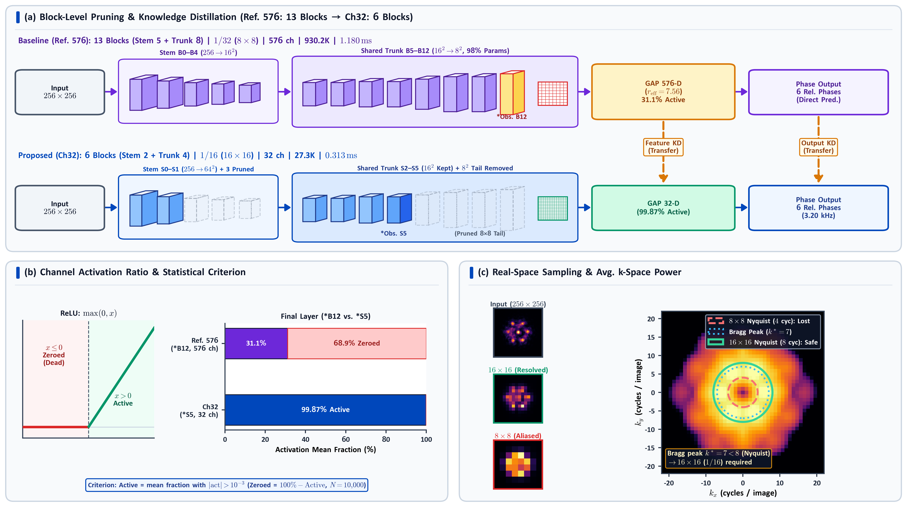
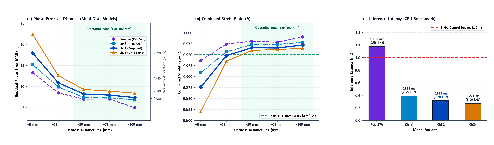

# Technical Companion: Deep Learning for Single-Step Phase Optimization in CBC

> **Supplement to our poster** — *Sang-Eon Park¹, Sungmin Park¹, Dong-Il Yeom¹,\** (¹Dept. of Energy Systems Research, Ajou University)  
> Designed for **mobile reading**: covers the **layer-by-layer network architecture, step-by-step PCA procedure, Shannon-entropy effective rank ($r_{\mathrm{eff}}$) meaning, loss/KD formulation, and dataset-independent PyTorch code** that could not fit on the poster.  
> [한국어 상세 기술 문서 (docs/THEORY_AND_MODELS.md)](docs/THEORY_AND_MODELS.md)

---

## 1. Layer-by-Layer Model Architectures (`Ref. 576` vs. `Ch32`)

The baseline (`Modified MobileNetV3-Small`) splits into **5 distance-specific stem blocks (`2.0%` params)** and **8 shared trunk blocks (`98.0%` params)**. Over **73% of its parameters** reside in the tail (`Stages 9–12`, `8×8` resolution, `96 → 576` channels), even though the 576-D feature space only uses $r_{\mathrm{eff}} = 7.56$ effective channels.

Our compressed **`Ch32`** (`27.3K` single-deploy params, **`-97.1%`**) is designed with three rules:
1. **Depth pruning (`13 → 6` blocks):** 2 distance-specific stem blocks + 4 shared trunk blocks.
2. **Nyquist spatial preservation (`1/32 → 1/16`):** Keeps a **`16×16` spatial grid** (`Nyquist = 8 cyc/img`) instead of `8×8` (`4 cyc/img`) so the 7-beam Bragg carrier (`k* = 7 cyc/img`) is not aliased.
3. **Channel matching (`576 → 32`):** Matches width to $r_{\mathrm{eff}} = 7.56$ (~4× headroom), reducing dead filters from **`68.9%` → `0%` (`99.87%` active)**.



<details>
<summary><b>Layer-by-Layer Specs: Ref. 576 (13 Blocks) & Ch32 (6 Blocks) — Click to expand</b></summary>

#### Baseline `Ref. 576` (`1 × 256 × 256` input)
| Stage | Role | Block / Operator | Output `(C, H, W)` | Scale | Params |
| :---: | :---: | :--- | :---: | :---: | :---: |
| **0–4** | Distance Stem | `Conv(1→16, s=2)` + 4× `InvRes` (`s=2,2,1,2`) | `(40, 16, 16)` | `1/16` | `23,936` |
| **5–8** | Shared Trunk | 4× `InvRes` (`40→40→40→48→48, s=1, SE`) | `(48, 16, 16)` | `1/16` | `166,296` |
| **9** | Shared Trunk | `InvRes(48→96, s=2, SE)` | `(96, 8, 8)` | `1/32` | `91,848` |
| **10–11** | Shared Trunk | 2× `InvRes(96→96, s=1, SE)` | `(96, 8, 8)` | `1/32` | `588,192` |
| **12 + Head** | Expand & Reg. | `Conv1×1(96→576)` + `GAP` + `Linear(576, 6)` | `(6,)` | Global | `59,910` |

#### Proposed `Ch32` (`1 × 256 × 256` input, `27,302` single-deploy params)
| Stage | Role | Operator `(in_c → exp_c → out_c, k, s)` | Output `(C, H, W)` | Scale | Params |
| :---: | :---: | :--- | :---: | :---: | :---: |
| **Stage 0** | Distance Stem | `Conv2d(1→16, k=3, s=2) + BN + Hardswish` | `(16, 128, 128)` | `1/2` | `176` |
| **Stage 1** | Distance Stem | `InvRes(16→24→16, k=3, s=2, ReLU)` | `(16, 64, 64)` | `1/4` | `1,112` |
| **Stage 2** | Shared Trunk | `InvRes(16→48→24, k=3, s=2, ReLU)` | `(24, 32, 32)` | `1/8` | `2,592` |
| **Stage 3** | Shared Trunk | `InvRes(24→48→24, k=5, s=1, SE, HS)` | `(24, 32, 32)` | `1/8` | `5,344` |
| **Stage 4** | Shared Trunk | `InvRes(24→72→32, k=5, s=2, SE, HS)` | `(32, 16, 16)` | `1/16` | `9,736` |
| **Stage 5** | Shared Trunk | `InvRes(32→64→32, k=5, s=1, SE, HS)` | `(32, 16, 16)` | `1/16` | `8,144` |
| **GAP + Head** | Phase Reg. | `AdaptiveAvgPool2d(1) + Linear(32, 6)` | `(6,)` | Global | `198` |

*(Variants `Ch24` = `16.4K` and `Ch48` = `46.0K` adjust only the Stage 2–5 channel widths.)*

</details>

---

## 2. Step-by-Step PCA & Shannon Entropy ($r_{\mathrm{eff}}$) Analysis

How we quantify feature-space redundancy from $N = 10{,}000$ validation frames across $D = 576$ channels:

1. **Center the GAP feature matrix** $\mathbf{X} \in \mathbb{R}^{N \times D}$:
   $$\tilde{\mathbf{X}} = \mathbf{X} - \bar{\mathbf{X}}, \qquad \mathbf{C} = \frac{1}{N - 1}\tilde{\mathbf{X}}^\top \tilde{\mathbf{X}} \in \mathbb{R}^{D \times D}$$
2. **Eigendecomposition & PCA cumulative variance:** Sort eigenvalues $\lambda_1 \ge \lambda_2 \ge \dots \ge \lambda_D \ge 0$ of $\mathbf{C}$. The top $k$ principal components capture $\sum_{i=1}^k \lambda_i / \sum_{j=1}^D \lambda_j$ of total variance (**7 PCs $\ge 90\%$**, **9 PCs $\ge 95\%$**).
3. **Shannon entropy ($H$) & Effective Rank ($r_{\mathrm{eff}}$) [4]:** Normalize eigenvalues into a probability distribution $p_i = \lambda_i / \sum_{j=1}^D \lambda_j$:
   $$H = -\sum_{p_i > 0} p_i \ln p_i, \qquad r_{\mathrm{eff}} = \exp(H) = 7.56, \qquad \eta_{\mathrm{info}} = \frac{H}{\ln D} \times 100\%$$
   - **Extreme low-rank ($H \approx 0$):** One mode dominates $\Rightarrow r_{\mathrm{eff}} \approx 1$.
   - **Full-rank uniform ($H = \ln D$):** All $D$ channels carry equal independent variance $\Rightarrow r_{\mathrm{eff}} = D$.
   - **Physical meaning:** $r_{\mathrm{eff}} = 7.56$ means the 576-D vector effectively uses **~8 independent feature channels** (`98.7%` redundant); compressing `576 → 32` raises information efficiency $\eta_{\mathrm{info}}$ from **`31.8%` → `57.8%`**.
   - *(Note: Using the uncentered Gram matrix $\mathbf{G} = \frac{1}{N}\mathbf{X}^\top\mathbf{X}$ yields **RankMe** [5].)*


<details>
<summary><b>Generic NumPy Implementation: PCA, Shannon Entropy (r_eff) & RankMe</b></summary>

```python
import numpy as np

def analyze_effective_rank_and_pca(features: np.ndarray, active_thresh: float = 1e-3):
    """features: (N, D) array from any network's pooled layer."""
    N, D = features.shape
    X_c = features - features.mean(axis=0, keepdims=True)
    eigvals = np.maximum(np.linalg.eigvalsh((X_c.T @ X_c) / (N - 1))[::-1], 0.0)
    p = eigvals / (eigvals.sum() + 1e-15)
    p_nz = p[p > 1e-15]

    h_ent = float(-np.sum(p_nz * np.log(p_nz)))
    r_eff = float(np.exp(h_ent))
    info_eff_pct = float(h_ent / np.log(D) * 100.0)
    cum_pca_pct = np.cumsum(p) * 100.0

    active_frac = (np.abs(features) > active_thresh).mean(axis=0)
    return {
        "r_eff": r_eff,
        "info_efficiency_pct": info_eff_pct,
        "pc_for_90pct": int(np.searchsorted(cum_pca_pct, 90.0) + 1),
        "dead_filters": int((active_frac < 0.20).sum()),
    }
```

</details>

---

## 3. Physics, Periodic Loss & Dual Knowledge Distillation

- **Defocus symmetry breaking ($\Delta z > 0$):** At $\Delta z = 0\text{ mm}$, $I(\mathbf{r}; -\boldsymbol{\phi}) = I(-\mathbf{r}; +\boldsymbol{\phi})$ causes conjugate ambiguity (`MAE 32.51°`). Fresnel diffraction $\exp(ikr^2/2\Delta z)$ breaks this symmetry (`MAE 4.35°–6.11°`, `Strehl ≥ 0.984` over `+25~+100 mm`).
- **Cyclical $2\pi$ cosine loss & dual KD:** Because phase wraps on $(-\pi, \pi]$, we train with periodic cosine loss plus output & feature distillation from `Ref. 576`:
  $$\mathcal{L} = \mathcal{L}_{\mathrm{cos}}(\hat{\boldsymbol{\phi}}_S, \boldsymbol{\phi}) + 0.5\,\mathcal{L}_{\mathrm{cos}}(\hat{\boldsymbol{\phi}}_S, \hat{\boldsymbol{\phi}}_T) + 0.1\Big(1 - \cos(\mathbf{P}\mathbf{z}_S, \mathbf{z}_T)\Big), \qquad \mathcal{L}_{\mathrm{cos}}(\hat{\boldsymbol{\phi}}, \boldsymbol{\phi}) = \frac{1}{6}\sum_{m=1}^6 (2 - 2\cos(\phi_m - \hat{\phi}_m))$$




---

## 4. Generic Example Code & Required Libraries

This repository contains **only generic model definitions, analytical tools, and synthetic-tensor demos** (no proprietary lab datasets or private checkpoints).

### Required Libraries
```bash
pip install -r requirements.txt
```
- `torch >= 2.1.0`
- `torchvision >= 0.16.0`
- `numpy >= 1.24.0`

### Run the Dataset-Independent Demo
```bash
python scripts/analyze_models_demo.py
```
Verifies parameter counts (`Ref. 576` vs. `Ch48 / Ch32 / Ch24`), cyclical phase loss & Strehl metric, effective rank ($r_{\mathrm{eff}}$) on synthetic low-rank features, and single-frame PyTorch CPU latency.

---

## 5. References

- **[1]** P. Zhou et al., *"Review of Coherent Laser Beam Combining Research Progress in the Past Decade,"* Chin. J. Lasers **48**(4), 0401003 (2021). [DOI: 10.3788/CJL202148.0401003](https://doi.org/10.3788/CJL202148.0401003)
- **[2]** H. Jia et al., *"A phase-error prediction method for coherent beam combining via convolutional neural network,"* Optik **246**, 167827 (2021). [DOI: 10.1016/j.ijleo.2021.167827](https://doi.org/10.1016/j.ijleo.2021.167827)
- **[3]** Y. Xie et al., *"Single-step phase identification and phase locking for coherent beam combination using deep learning,"* Sci. Rep. **14**, 7501 (2024). [DOI: 10.1038/s41598-024-58118-3](https://doi.org/10.1038/s41598-024-58118-3)
- **[4]** O. Roy & M. Vetterli, *"The effective rank: A measure of effective dimensionality,"* Proc. EUSIPCO, 606–610 (2007). [IEEE Xplore](https://ieeexplore.ieee.org/document/7098875)
- **[5]** Q. Garrido et al., *"RankMe: Assessing the downstream performance of pretrained self-supervised representations by their rank,"* ICML, PMLR **202**, 10929–10974 (2023). [PMLR](https://proceedings.mlr.press/v202/garrido23a.html)
