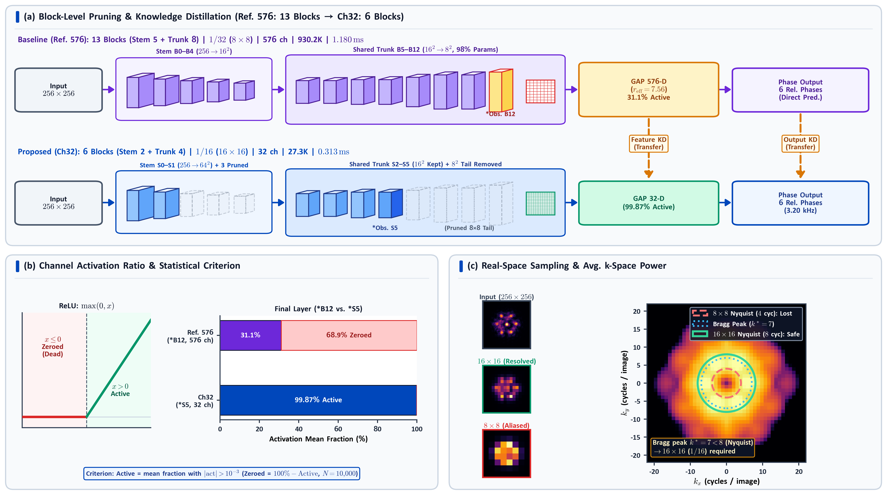
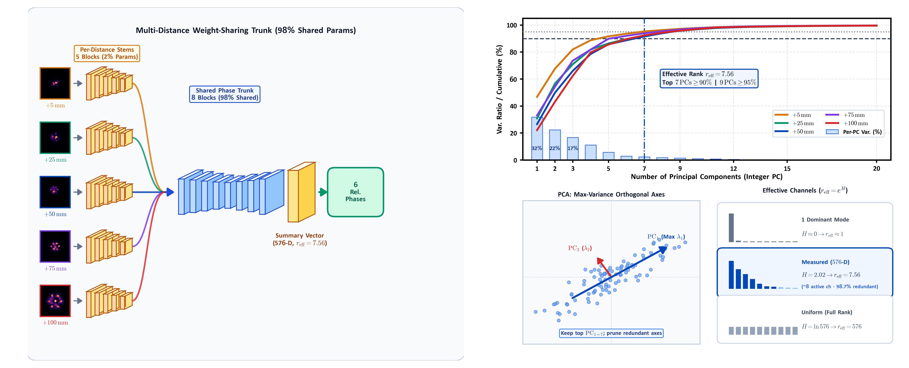

# 결맞음 빔 결합(CBC) 위상 복원 모델

[English](README.md) | 한국어

포스터 보충 자료 — 박상언, 박성민, 염동일 (아주대학교 에너지시스템학과).

모델 레이어 구조, PCA·섀넌 엔트로피 기반 유효 랭크 분석, 임시 텐서 추론 시간 측정 코드만 정리했습니다. 데이터셋과 학습 가중치는 포함하지 않습니다.

---

## 1. 모델 구조

입력은 `(1, 256, 256)` 흑백 간섭 영상이고, 출력은 6개 상대 위상(rad, 0번 빔 기준)입니다.
다중 거리 학습에서는 초기 stem만 거리별로 복제하고 trunk와 head는 공유합니다. 단일 거리 배포 시에는 1개 stem + trunk + linear head를 사용합니다.

| 모델 | 블록 수 | 최종 격자 | 파라미터 |
| :--- | :---: | :---: | :---: |
| `Ref. 576` | `5 + 8` | `576×8×8` | `930,182` |
| `Ch48` | `2 + 4` | `48×16×16` | `46,022` |
| `Ch32` | `2 + 4` | `32×16×16` | `27,302` |
| `Ch24` | `2 + 4` | `24×16×16` | `16,406` |



<details>
<summary>Ref. 576 (변형 MobileNetV3-Small, 13블록)</summary>

| 단계 | 연산 | 출력 `(C, H, W)` | 파라미터 |
| :--- | :--- | :---: | :---: |
| `0 (Stem)` | `Conv 1→16, k3 s2, HS` | `16, 128, 128` | `176` |
| `1 (Stem)` | `InvRes 16→16→16, k3 s2, SE, RE` | `16, 64, 64` | `744` |
| `2 (Stem)` | `InvRes 16→72→24, k3 s2, RE` | `24, 32, 32` | `3,864` |
| `3 (Stem)` | `InvRes 24→88→24, k3 s1, RE` | `24, 32, 32` | `5,416` |
| `4 (Stem)` | `InvRes 24→96→40, k5 s2, SE, HS` | `40, 16, 16` | `13,736` |
| `5 (Trunk)` | `InvRes 40→240→40, k5 s1, SE, HS` | `40, 16, 16` | `57,264` |
| `6 (Trunk)` | `InvRes 40→240→40, k5 s1, SE, HS` | `40, 16, 16` | `57,264` |
| `7 (Trunk)` | `InvRes 40→120→48, k5 s1, SE, HS` | `48, 16, 16` | `21,968` |
| `8 (Trunk)` | `InvRes 48→144→48, k5 s1, SE, HS` | `48, 16, 16` | `29,800` |
| `9 (Trunk)` | `InvRes 48→288→96, k5 s2, SE, HS` | `96, 8, 8` | `91,848` |
| `10 (Trunk)` | `InvRes 96→576→96, k5 s1, SE, HS` | `96, 8, 8` | `294,096` |
| `11 (Trunk)` | `InvRes 96→576→96, k5 s1, SE, HS` | `96, 8, 8` | `294,096` |
| `12 (Trunk)` | `Conv 96→576, k1 s1, HS` | `576, 8, 8` | `56,448` |
| `GAP + FC` | `AvgPool(1) + Linear(576→6)` | `6` | `3,462` |

Stage 9–12 (`8×8` 구간): `736,488`개 (전체의 `79.2%`).

</details>

<details>
<summary>Ch32 (6블록, 27,302 파라미터)</summary>

| 단계 | 연산 | 출력 `(C, H, W)` | 파라미터 |
| :--- | :--- | :---: | :---: |
| `0 (Stem)` | `Conv 1→16, k3 s2, HS` | `16, 128, 128` | `176` |
| `1 (Stem)` | `InvRes 16→24→16, k3 s2, RE` | `16, 64, 64` | `1,112` |
| `2 (Trunk)` | `InvRes 16→48→24, k3 s2, RE` | `24, 32, 32` | `2,592` |
| `3 (Trunk)` | `InvRes 24→48→24, k5 s1, SE, HS` | `24, 32, 32` | `5,344` |
| `4 (Trunk)` | `InvRes 24→72→32, k5 s2, SE, HS` | `32, 16, 16` | `9,736` |
| `5 (Trunk)` | `InvRes 32→64→32, k5 s1, SE, HS` | `32, 16, 16` | `8,144` |
| `GAP + FC` | `AvgPool(1) + Linear(32→6)` | `6` | `198` |

</details>

<details>
<summary>Ch48 (46,022) & Ch24 (16,406)</summary>

두 모델 모두 `Ch32`와 동일한 `Stage 0–1` stem(`1,288` 파라미터)을 사용합니다.

#### `Ch48` Trunk + Head
| 단계 | 연산 | 출력 `(C, H, W)` | 파라미터 |
| :--- | :--- | :---: | :---: |
| `2 (Trunk)` | `InvRes 16→48→24, k3 s2, RE` | `24, 32, 32` | `2,592` |
| `3 (Trunk)` | `InvRes 24→72→32, k5 s1, SE, HS` | `32, 32, 32` | `9,736` |
| `4 (Trunk)` | `InvRes 32→96→48, k5 s2, SE, HS` | `48, 16, 16` | `15,288` |
| `5 (Trunk)` | `InvRes 48→96→48, k5 s1, SE, HS` | `48, 16, 16` | `16,824` |
| `GAP + FC` | `AvgPool(1) + Linear(48→6)` | `6` | `294` |

#### `Ch24` Trunk + Head
| 단계 | 연산 | 출력 `(C, H, W)` | 파라미터 |
| :--- | :--- | :---: | :---: |
| `2 (Trunk)` | `InvRes 16→32→16, k3 s2, RE` | `16, 32, 32` | `1,472` |
| `3 (Trunk)` | `InvRes 16→32→24, k5 s1, SE, HS` | `24, 32, 32` | `2,808` |
| `4 (Trunk)` | `InvRes 24→48→24, k5 s2, SE, HS` | `24, 16, 16` | `5,344` |
| `5 (Trunk)` | `InvRes 24→48→24, k5 s1, SE, HS` | `24, 16, 16` | `5,344` |
| `GAP + FC` | `AvgPool(1) + Linear(24→6)` | `6` | `150` |

</details>

`InvRes(in→exp→out)`: MobileNetV3 inverted residual 블록 (`SE`: squeeze-and-excitation, `RE`: ReLU, `HS`: Hardswish).

---

## 2. 유효 랭크 분석 (PCA & 섀넌 엔트로피)

5개 거리 검증 샘플($N = 10{,}000$)의 GAP 특징 행렬 $\mathbf{X} \in \mathbb{R}^{N \times D}$, 평균 중심화 행렬 $\tilde{\mathbf{X}} = \mathbf{X} - \bar{\mathbf{X}}$:

$$\mathbf{C} = \frac{1}{N - 1}\tilde{\mathbf{X}}^\top \tilde{\mathbf{X}}, \qquad p_i = \frac{\lambda_i}{\sum_{j=1}^{D}\lambda_j}$$

$$H = -\sum_{p_i > 0} p_i \ln p_i, \qquad r_{\mathrm{eff}} = e^{H}, \qquad \eta_{\mathrm{info}} = \frac{H}{\ln D}$$

$r_{\mathrm{eff}} \in [1, D]$: 실질적으로 작동하는 독립 특징 모드 수 (단일 모드 지배 시 `1`, 전 차원 균일 분산 시 `D`) [1]. 공분산 $\mathbf{C}$ 대신 비중심 그람 행렬을 사용하면 RankMe가 됩니다 [2].

활성 비율은 GAP 출력 중 `|x| > 1e-3` 인 원소의 평균 비율입니다.

| 모델 (`D`) | $r_{\mathrm{eff}}$ | $\eta_{\mathrm{info}}$ | 활성 비율 |
| :--- | :---: | :---: | :---: |
| `Ref. 576` | `7.56` | `31.8%` | `31.1%` |
| `Ch48` | `7.31` | `51.4%` | `99.85%` |
| `Ch32` | `7.40` | `57.8%` | `99.87%` |
| `Ch24` | `7.25` | `62.3%` | `99.88%` |

`Ref. 576`은 상위 7개 주성분이 전체 분산의 ≥ 90%(상위 9개 ≥ 95%)를 설명하며, `Ch32`는 상위 6개 주성분이 ≥ 94%를 설명합니다.



<details>
<summary>NumPy 코드: effective_rank(X)</summary>

```python
import numpy as np

def effective_rank(X: np.ndarray, active_thresh: float = 1e-3):
    N, D = X.shape
    X_c = X - X.mean(axis=0, keepdims=True)
    eig = np.maximum(np.linalg.eigvalsh((X_c.T @ X_c) / (N - 1))[::-1], 0.0)
    p = eig / (eig.sum() + 1e-15)
    p_nz = p[p > 1e-15]
    H = -np.sum(p_nz * np.log(p_nz))
    return {
        "r_eff": float(np.exp(H)),
        "eta_info_pct": float(H / np.log(D) * 100.0),
        "pc_90": int(np.searchsorted(np.cumsum(p), 0.90) + 1),
        "active_pct": float((np.abs(X) > active_thresh).mean() * 100.0),
    }
```

</details>

---

## 3. 추론 시간 테스트

```bash
pip install -r requirements.txt
python benchmark.py
```

옵션 예시:

```bash
python benchmark.py --runs 200 --warmup 30 --threads 4 --device cpu --rank-demo
```

`benchmark.py`는 최소 라이브러리(`torch`, `torchvision`, `numpy`)만 사용하여 `(1, 1, 256, 256)` 임시 텐서로 PyTorch eager 모드 추론 시간을 측정합니다. 포스터에 표기된 수치(`Ref. 576 / Ch48 / Ch32 / Ch24`: `1.180 / 0.392 / 0.313 / 0.271 ms`)는 ONNX Runtime FP32(4스레드, Ryzen 7 9800X3D) 기준입니다.

---

## 참고문헌

- `[1]` O. Roy & M. Vetterli, "The effective rank: A measure of effective dimensionality," *Proc. EUSIPCO*, pp. 606–610 (2007).
- `[2]` Q. Garrido et al., "RankMe: Assessing the downstream performance of pretrained self-supervised representations by their rank," *Proc. ICML*, PMLR 202, pp. 10929–10974 (2023).
